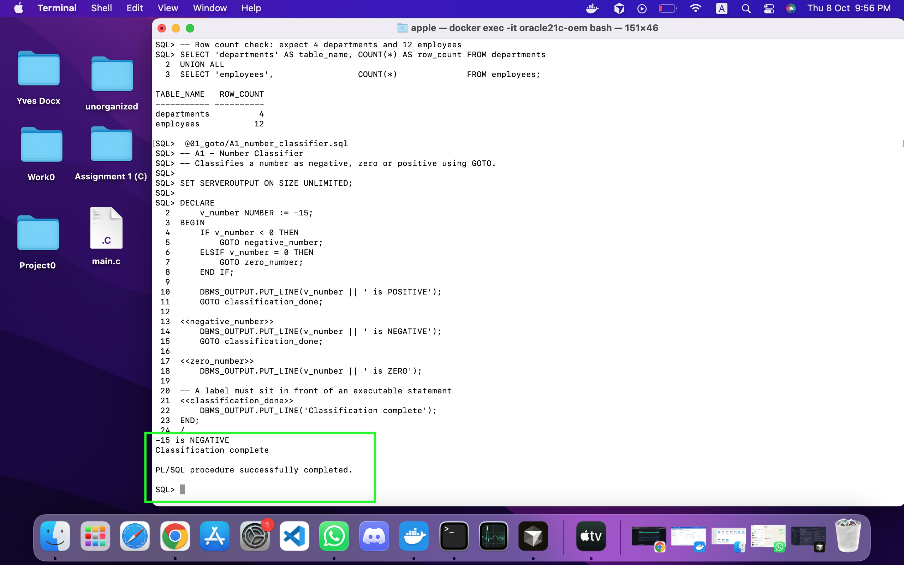
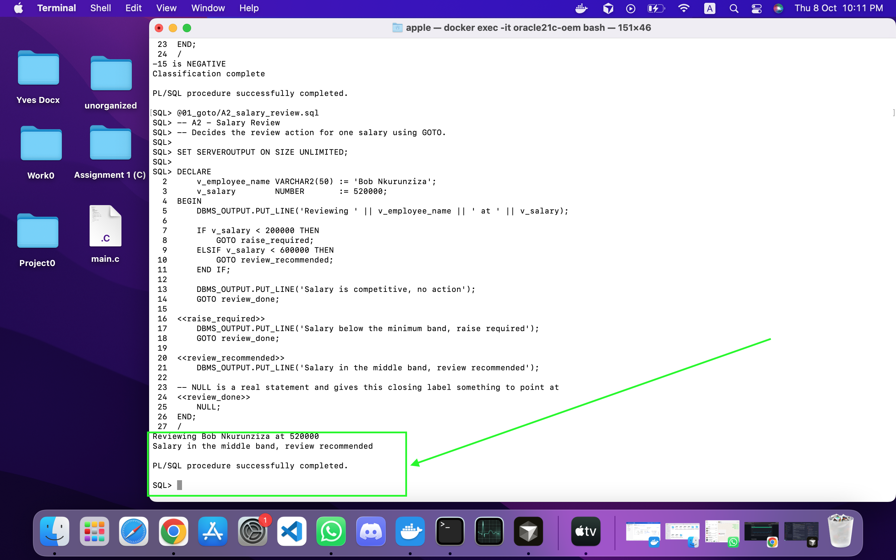
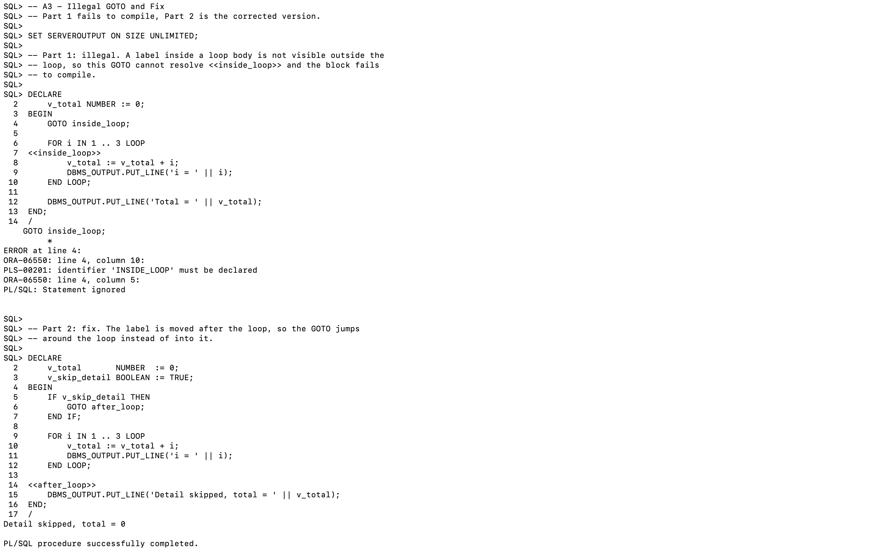
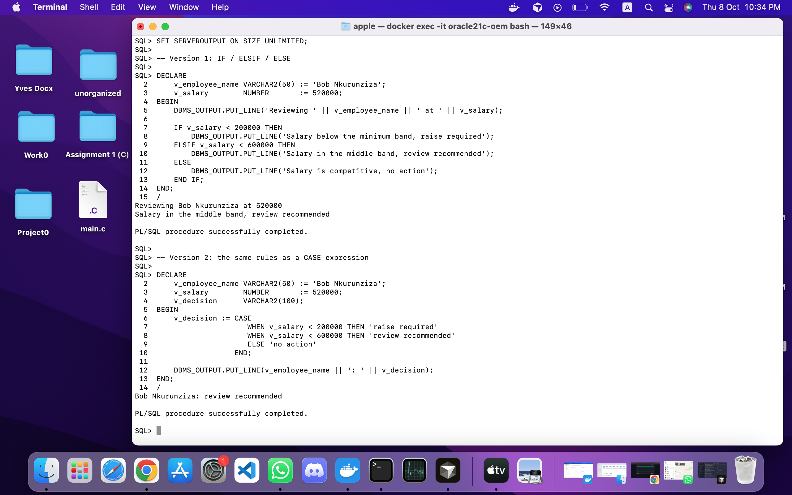
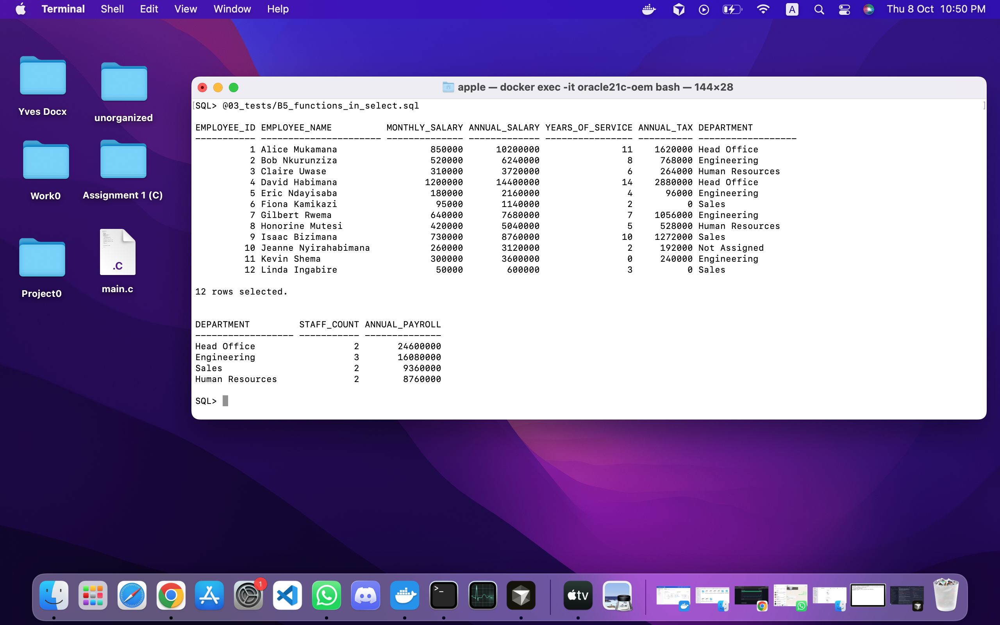
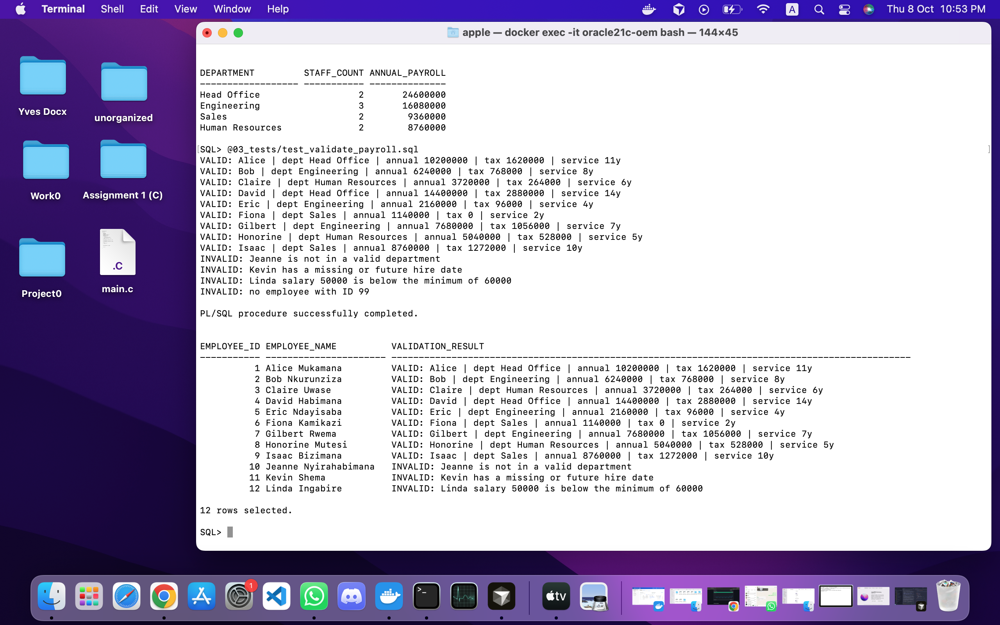

# PL/SQL GOTO Statements and Functions – Individual Assignment III

| Field | Details |
|---|---|
| **Student Name** | MUGISHA Yves |
| **Student ID** | 20251SEN202 |
| **Course** | Database Development with PL/SQL (INSY 8311) |
| **Instructor** | Eric Maniraguha |
| **Deadline** | Thursday, October 8, 2026, 11:59 PM |
| **Database** | Oracle Database 21c Express Edition, 21.3.0.0.0 |

---

## Overview

This assignment has three parts. Part A uses `GOTO` to control program flow,
then removes it. Part B builds four stored functions over a small payroll
schema and calls them from a `SELECT`. Part C combines both into one function
that validates an employee's payroll record.

| # | Task | File |
|---|---|---|
| A1 | Number Classifier | `01_goto/A1_number_classifier.sql` |
| A2 | Salary Review | `01_goto/A2_salary_review.sql` |
| A3 | Illegal GOTO and Fix | `01_goto/A3_illegal_goto.sql` |
| A4 | Rewrite Without GOTO | `01_goto/A4_rewrite_no_goto.sql` |
| B1 | Annual Salary | `02_functions/B1_fn_annual_salary.sql` |
| B2 | Years of Service | `02_functions/B2_fn_years_of_service.sql` |
| B3 | Tax Calculator | `02_functions/B3_fn_calculate_tax.sql` |
| B4 | Department Name | `02_functions/B4_fn_dept_name.sql` |
| B5 | Functions in SQL | `03_tests/B5_functions_in_select.sql` |
| C1 | Payroll Validator | `02_functions/C1_fn_validate_payroll.sql` |
| C2 | Reflection | `docs/REFLECTION.md` |

---

## Repository Structure

```
plsql-goto-functions-20251SEN202-yves/
├── README.md
├── .gitignore
├── 00_setup/create_tables.sql
├── 01_goto/            A1 to A4
├── 02_functions/       B1 to B4 and C1
├── 03_tests/           B5 and the test scripts
├── screenshots/        6 output screenshots
└── docs/REFLECTION.md
```

---

## How to Run

Run the files in this order. The functions must exist before the tests call
them, and `C1` must come last because it uses the other four.

```sql
@00_setup/create_tables.sql

@02_functions/B1_fn_annual_salary.sql
@02_functions/B2_fn_years_of_service.sql
@02_functions/B3_fn_calculate_tax.sql
@02_functions/B4_fn_dept_name.sql
@02_functions/C1_fn_validate_payroll.sql

@01_goto/A1_number_classifier.sql
@01_goto/A2_salary_review.sql
@01_goto/A3_illegal_goto.sql
@01_goto/A4_rewrite_no_goto.sql

@03_tests/test_functions.sql
@03_tests/B5_functions_in_select.sql
@03_tests/test_validate_payroll.sql
```

Every script turns on `SET SERVEROUTPUT ON`. Without it,
`DBMS_OUTPUT.PUT_LINE` writes to a buffer and you see nothing.

---

## Database Design

Two tables: `departments` (4 rows) and `employees` (12 rows). Salaries are
stored **monthly**; `fn_annual_salary` works out the yearly figure.

**departments** — `department_id` (PK), `department_name`, `location`

**employees** — `employee_id` (PK), `first_name`, `last_name`, `hire_date`,
`salary`, `department_id`

Employees 1 to 9 are normal records. The last three are wrong on purpose so
the Part C validator has real failures to catch. There are no `CHECK`
constraints on `employees` for the same reason.

| ID | Employee | Problem |
|---|---|---|
| 10 | Jeanne Nyirahabimana | no department |
| 11 | Kevin Shema | hire date is in the future |
| 12 | Linda Ingabire | salary below the 60,000 minimum |

---

## Part A – GOTO

`GOTO` jumps to a label written as `<<label>>`. Two rules matter here:

1. A label must come before a real statement. It cannot be the last thing in
   a block, which is why `NULL;` follows `<<review_done>>` in A2 — `NULL;` is
   a do-nothing statement that gives the label something to point at.
2. A `GOTO` can jump **out of** an `IF` or a loop, but never **into** one.

### A1 – Number Classifier

Classifies a number as negative, zero or positive. The `IF` jumps to
`<<negative_number>>` or `<<zero_number>>`; if neither matches, the number is
positive. Each branch then jumps to `<<classification_done>>` so the other
branches cannot run.



### A2 – Salary Review

The same pattern applied to salary bands: below 200,000 needs a raise, below
600,000 needs a review, anything higher needs no action. This file shows the
`NULL;` after the closing label.



### A3 – Illegal GOTO and Fix

Part 1 tries to jump into the middle of a `FOR` loop from outside it. It fails
with `PLS-00201: identifier 'INSIDE_LOOP' must be declared`. The reason is
scope: a label written inside a loop is not visible outside that loop, so the
`GOTO` cannot find the name at all. That is exactly why you can never jump
into a loop. The error happens at compile time, so the block never runs and no
`i = ...` line is printed.

Part 2 keeps the same idea — skip the detail lines — but puts the label
*after* the loop. Now the jump goes around the loop instead of into it, which
is legal, and the block runs.



### A4 – Rewrite Without GOTO

A2 written twice without `GOTO`: once with `IF / ELSIF / ELSE`, once with a
`CASE` expression. Both give the same result as A2. The structured versions
are shorter and you can see which lines run without tracing any jumps. The
`CASE` version also separates the decision from the printing, so the rule
could be reused without repeating the output line.



---

## Part B – Functions

A function declares its return type in the header and returns a value in the
body. There is no `DECLARE` keyword — the space between `IS` and `BEGIN` is
the declaration section. Every file ends with `SHOW ERRORS`, because Oracle
reports compilation errors as a *warning* and leaves the broken function in
place, so `Function created.` on its own is not proof that it works.

### B1 – `fn_annual_salary(p_monthly_salary) RETURN NUMBER`

Monthly salary × 12. The guard clause returning 0 for `NULL` or negative input
makes sure **every path returns a value**. A path with no `RETURN` compiles
fine and then fails at run time with `ORA-06503`.

### B2 – `fn_years_of_service(p_hire_date) RETURN NUMBER`

`TRUNC(MONTHS_BETWEEN(SYSDATE, p_hire_date) / 12)`. `MONTHS_BETWEEN` is used
instead of dividing a day count by 365, which drifts on leap years. `TRUNC`
gives completed years, so 4 years 11 months counts as 4. A missing or future
date returns 0 — C1 reports the future date as an error instead, so each
function does one job.

### B3 – `fn_calculate_tax(p_annual_income) RETURN NUMBER`

Progressive tax on **annual** income. Each rate applies only to the part of
the income inside its own band, the way real income tax works.

| Annual income | Rate on that part |
|---|---|
| up to 1,200,000 | 0% |
| 1,200,001 – 3,600,000 | 10% |
| 3,600,001 – 9,600,000 | 20% |
| above 9,600,000 | 30% |

Example — Alice earns 850,000 a month, so 10,200,000 a year:
`0` + `10% × 2,400,000` + `20% × 6,000,000` + `30% × 600,000` = **1,620,000**.

### B4 – `fn_dept_name(p_department_id) RETURN VARCHAR2`

A `SELECT INTO` lookup, and the only function that needs an `EXCEPTION` block.
`SELECT INTO` does not return an empty result when nothing matches — it raises
`NO_DATA_FOUND`, and raises `TOO_MANY_ROWS` if several rows match. Both are
handled, so a bad department id returns a readable label instead of breaking
the query that called it.

### B5 – Functions in SQL

`03_tests/B5_functions_in_select.sql` calls all four functions in one `SELECT`,
including one nested call, `fn_calculate_tax(fn_annual_salary(e.salary))`, and
then uses them in `WHERE`, `GROUP BY` and `ORDER BY`.

A function used in SQL must return a **SQL** type, so `BOOLEAN` is not allowed,
and it must not change data. Both rules shaped the design of C1.



---

## Part C – Combined

### C1 – `fn_validate_payroll(p_employee_id) RETURN VARCHAR2`

Reads one employee, checks three rules, and returns either a `VALID` line with
the calculated figures or an `INVALID` line saying what is wrong. It calls all
four Part B functions.

It returns `VARCHAR2` and not `BOOLEAN` for the reason given in B5 — a
`BOOLEAN` function cannot be used in a `SELECT`, and `test_validate_payroll.sql`
does exactly that.

It uses both kinds of exception:

- **User-defined**, declared in the header and raised with `RAISE`:
  `salary_too_low`, `hire_date_in_future`, `unknown_department`.
- **Predefined**: `NO_DATA_FOUND`, for an employee id that does not exist.
- **`WHEN OTHERS` with `SQLERRM`** as a catch-all.

Raising a named exception instead of returning a message at each check keeps
the main path easy to read: three checks and one `RETURN`, with all the
message text in the `EXCEPTION` block.



### C2 – Reflection

See [`docs/REFLECTION.md`](docs/REFLECTION.md).

---

## Challenges Encountered

**A label cannot end a block.** My first version of A2 had `<<review_done>>`
right before `END;` and would not compile. A label must come before a real
statement, so the closing label needs `NULL;` after it.

**A function can compile and still be broken.** `CREATE OR REPLACE FUNCTION`
reports errors as a warning and keeps the broken function, so the next script
seems fine until something calls it. Adding `SHOW ERRORS` after every create
showed the problem straight away.

**`SELECT INTO` raises an error instead of returning nothing.** `fn_dept_name`
found no row for employee 10, who has no department, and the error stopped the
whole `SELECT` in B5 rather than just that one row. Handling `NO_DATA_FOUND`
and adding a `NULL` check fixed it. This was the clearest difference I found
between PL/SQL and plain SQL.

**Output columns were unreadable.** A function returning `VARCHAR2` is given
the maximum width by SQL*Plus, so the department column was printed 180
characters wide and wrapped onto its own line. Adding `COLUMN ... FORMAT A18`
to the test scripts made the results line up as a proper table.

---

## Notes

**Use of an AI assistant.** I used an AI assistant to help me understand
concepts from the lecture notes that I found difficult, to help with debugging
when a script failed, and to refine this documentation from my own notes and
ideas — mainly grammar and wording.

I set up the database and ran every script myself in my own Oracle environment,
checked the output against values I worked out by hand, and took all the
screenshots. I understand the submitted code and can explain any part of it.

---

## Submission

```
Repository: https://github.com/Yves-Developer/plsql-goto-functions-20251SEN202-yves
Visibility: Public
Submitted via: Google Form
```
